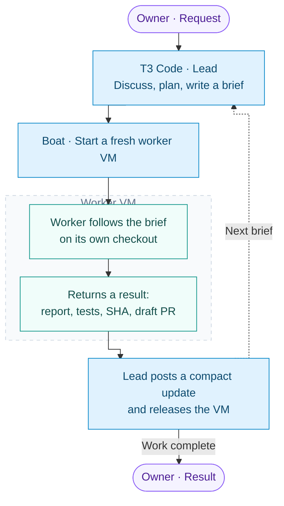
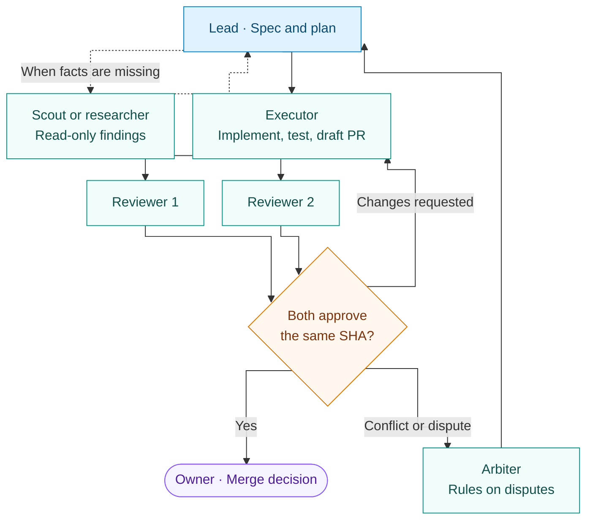

<h1 align="center">⛵ T3 Boat</h1>

<p align="center"><strong>Run a team of coding agents on disposable Boat VMs from T3 Code.</strong></p>

<p align="center">
  <a href="https://github.com/pogorelov17/t3-boat/actions/workflows/release.yml"></a>
  <a href="https://hub.docker.com/r/pogorelov17/t3-boat"></a>
</p>

<p align="center">
  <a href="#quick-start">Quick start</a> · <a href="https://hub.docker.com/r/pogorelov17/t3-boat">Docker Hub ↗</a> · <a href="https://github.com/pogorelov17/agent-playbook">Agent Playbook ↗</a>
</p>



Coordinate coding agents across your GitHub projects from one Linux machine, local or remote. Bring an idea or an existing repository and work from a T3 chat with Codex, Claude or both. The code itself runs on disposable Boat VMs.

## How it works

Suppose you ask in T3, “Fix the failing test and show me why it broke.”

1. **The team lead talks with you in T3.** It discusses, plans and checks a fact on the web when needed. New chats in all your projects inherit your installation’s lead model and reasoning level. While you are still discussing an idea, the conversation stays in T3 until there is work for a worker.
2. **Workers run on Boat.** The lead starts a generic worker on a disposable VM and gives it a brief it writes for this task: here, reproduce the failure, fix it, run the tests and open a draft PR. Everything that touches the repository runs there: reading source, edits, installs, builds, tests and extended research. Your machine only hosts T3 and its history. The lead decides how many workers to use and what each does; no roles or reviews are required.
3. **The parent chat stays compact.** For each delegation, result and decision, the lead posts who asked whom for what, known dependencies, the result and what it decided, with links to the child chat and the PR instead of shell logs. It reports what it observed; T3 shows a child’s link and the result it returns, not its live progress.
4. **You decide when to merge.** Once a worker’s result is recorded, its VM is deleted. You can come back to the chat or ask for another change on the PR without keeping workers running.

Prefer a fixed team? The [optional role playbook](#optional-role-playbook) gives the lead an executor, two independent reviewers and an arbiter, with model rules between them.

## Quick start

You need a Linux machine with Docker Engine, a Boat account that can start a small VM, a GitHub account, and the subscriptions enabled in your profile. A repository is optional. The image supports AMD64 and ARM64. [Install Docker Engine](https://docs.docker.com/engine/install/).

### 1. Start the container

Run this on the server. Set `T3_BOAT_PROFILE` to `codex-only`, `claude-only`, or `codex+claude`. Docker downloads the published image on first use. T3 uses the container hostname as its display name. The example uses the server’s short hostname so you can recognize it on your devices.

```sh
docker run -d --name t3-boat --hostname "$(hostname -s)" --restart unless-stopped \
  -p 127.0.0.1:3773:3773 \
  -v t3-boat-data:/data \
  -e T3_BOAT_PROFILE=codex+claude \
  pogorelov17/t3-boat:0.1.5
```

### 2. Connect your accounts and verify a worker

Run this on the server. The live check uses a small Boat VM and one short model request per enabled provider.

```sh
docker exec -it t3-boat t3-boat setup
```

| Profile | Sign in on the T3 server | Connect in the Boat credential profile |
| --- | --- | --- |
| `codex-only` | Codex with ChatGPT | ChatGPT subscription |
| `claude-only` | Claude Code with Claude | Claude subscription |
| `codex+claude` | Both | Both subscriptions |

1. Follow the login prompts. Existing valid sessions are reused. For Claude profiles, setup keeps an installed Claude Code that is the pinned version or newer. If `claude --version` fails or prints nothing, setup reinstalls the pinned version. If it prints a version setup cannot read, setup leaves Claude Code unchanged and prints a warning. After sign-in, setup asks which workflow this machine uses: **generic** workers (the default for a new installation) or the [optional role playbook](#optional-role-playbook), and shows where the playbook’s files would go. For generic workers it then shows one model and reasoning level, the `lead` row, which your chats and every generic worker open with. For the role playbook it shows one for each role. Press **Enter** to accept or select a row to customize it. The workflow takes effect only when you accept the models; if setup stops before that, the machine keeps its previous workflow and files. At **GitHub repository URL**, enter a project URL or press **Enter** to open **Start here** with your own idea.
2. Approve the Boat device login if prompted. In Boat, connect GitHub. Open **Agents & Proxying**, select your worker credential profile and connect the subscriptions in the table. Boat supplies these logins to new VMs. Select a private worker environment that passes GitHub and agent credentials and uses that credential profile. For a repository, grant the Boat GitHub App access to that repository with **Contents** and **Pull requests** write permissions. [Boat environments](https://docs.boat.dev/environments/access) · [Worker subscriptions](https://docs.boat.dev/ai-credentials)
3. Setup starts a fresh VM, authenticates to GitHub from it and requests one reply from each enabled provider. If you supplied a repository, it also reads its Git refs from that VM. Look for each success line, the deleted VM ID and **Setup verified**. If a check fails, fix the reported connection and rerun setup.

**Installing with an AI agent?** Have the account owner complete browser confirmations directly. Report the profile, the local logins, the VM ID and deletion, the providers and models that replied, and the repository checked or deferred. Complete the first-chat check below. After reporting the results, offer the [optional phone setup](#connect-your-phone-optional) with the environment name you verified. If you know the owner’s platform, mention its store. Otherwise, offer both iOS and Android. A running container alone is only the first step.

### 3. Open your first chat

In T3, select your repository, or **Start here** if you skipped the URL, and open a new chat. Write in your own words, in any language. You can ask a question, share an idea, or use an opening message suggested by the agent helping you get set up.

<details>
<summary><strong>First time connecting this computer?</strong></summary>

If T3 runs on this computer, skip the SSH command and create the pairing link directly in a local terminal. For a remote machine, use SSH port forwarding. In a terminal on your computer, replace `USER@SERVER` with your SSH login and connect:

```sh
ssh -L 127.0.0.1:3773:127.0.0.1:3773 -o ExitOnForwardFailure=yes USER@SERVER
```

On the machine running Docker, get a pairing link:

```sh
docker exec -it t3-boat t3 auth pairing create --ttl 5m --base-url http://127.0.0.1:3773
```

For the desktop app, open **Settings → Environments → Add environment → Remote link** and paste the pairing URL. Opening the URL in a browser pairs that browser. Issue a fresh code to pair another client. For a remote machine, keep the SSH session open while using port forwarding. Closing that session or putting the computer to sleep interrupts this route. The container and chat history stay on the server. Run the SSH command again to reconnect to the same installation.

After a server rebuild, verify the new SSH host key fingerprint at the machine’s console before updating the saved key on your computer. If the installation also has a fresh data volume, pair the client to its new T3 environment.

</details>

<details>
<summary><strong>Keep T3 reachable when you close your laptop (T3 Connect)</strong></summary>

Pair your desktop app using the steps above first. On the server, link the container to your T3 Connect account. Follow the device approval prompt in your browser.

```sh
docker exec -it t3-boat t3 connect --headless
```

Once authorized, restart the container to apply the link. Do this between tasks. Docker already manages the server process if the CLI mentions a user-systemd service.

```sh
docker restart t3-boat
docker exec t3-boat t3 connect status --base-dir /data/.t3
```

Provisioning can take a moment. Repeat the status command until it reports **Other devices can reach this machine** and **Tunnel connected**. In the desktop app’s **Settings → Environments**, add **T3 Connect** as a route for the paired server. Close the SSH forward if you opened one, confirm the environment shows **via T3 Connect**, then send a message in a new chat. A reply confirms the route end to end. The tunnel runs on the server while your laptop sleeps.

A fresh data volume creates a new T3 environment. If an older entry shows **tunnel is offline**, select the newly paired environment.

</details>

If you are unsure where to begin, ask the team lead for ideas. Wait for a reply in the new chat to confirm your client can reach the team lead. Planning can continue there until you choose a repository.

## Build your first feature

1. **Choose the repository for this change.** Use the URL of any GitHub repository you can work on. For a brand-new project, initializing the repository with a README gives the first PR a base commit.
2. **Attach the repository.** If you supplied its URL during setup, continue to step 3. Otherwise rerun `docker exec -it t3-boat t3-boat setup` and enter the URL. Setup checks access from a fresh VM. The first real change exercises branch push and draft PR creation.
3. **Continue the conversation.** Use your project chat. If you began in **Start here**, attaching the first repository keeps your planning thread there. When you are ready, ask for the first change you want. A worker implements it on Boat, checks the result, and opens a draft PR. The parent chat records the worker’s model, test results and the PR’s head SHA. With the role playbook, two reviewers also examine the same commit on separate VMs. GitHub shows the draft PR and any checks configured by that repository. You decide when to merge.

To work on another repository, rerun setup with its URL. To inspect current local logins, Boat configuration and the timestamp of the last successful VM check, run `docker exec t3-boat t3-boat status`. Status does not allocate a VM. Rerun setup for a fresh check after changing profiles, credentials or models.

## Models

`T3_BOAT_PROFILE` names one of the model sets of [agent-playbook](https://github.com/pogorelov17/agent-playbook/tree/a27b16a7d6962df7b26fc3233b8503f973f8d715), pinned to commit `a27b16a7d696` and built into the image, so nothing is fetched while the container runs: `codex-only`, `claude-only` or `codex+claude`. Each set gives a row of the profile a provider, a model family and a reasoning level; see the [model set table](https://github.com/pogorelov17/agent-playbook/blob/a27b16a7d6962df7b26fc3233b8503f973f8d715/README.md#model-sets) for the defaults. The `lead` row is the model of your T3 chats. A generic worker opens with the same model and has every provider of the profile enabled, so the lead can pick another model and reasoning level for each brief. Generic workers need only this row. The role playbook adds a row for each role. Rows saved by an earlier role setup stay in the profile as presets that the lead can start with `boat-worker start ROW`.

On first setup, T3 + Boat picks the newest stable release of each family that T3 lists and that supports the suggested reasoning level. You see the exact model IDs before you accept them. Your choices apply to new chats in all projects on this machine.

With the role playbook, setup enforces the playbook’s model rules between the rows; generic workers do not need them, so saved presets are kept as they are. A model is its provider plus family, and a different reasoning level does not make it a different model: the `reviewer1`, `reviewer2` and `arbiter` rows must use a provider or family other than the `executor` row’s. The only exception is the one `codex-only` declares: `reviewer2` may use the executor’s Sol family at a different reasoning level, because Codex alone has too few families for two reviewers and an arbiter. By default both then use the newest Sol that supports both reasoning levels. Setup refuses any other shared family, and the same family at the same reasoning level.

**Change your choices later.** Run `docker exec -it t3-boat t3-boat setup` again. Setup keeps your saved versions until you edit a row or type `refresh` to return to the current family defaults. Rows you added yourself are kept. If a model or reasoning level is no longer available, choose a replacement before continuing.

## Optional role playbook

By default the team lead works with generic workers: it writes each brief and decides what to delegate. If you prefer a predefined team, choose **playbook** when setup asks for the workflow. Setup then asks for a model for each role, filling rows a generic profile lacks with the model set’s defaults. Every project on this machine then follows the playbook’s roles, and every worker has one: `boat-worker start` without a role is refused.



The executor implements the change and opens a draft PR. Two reviewers each get a fresh VM and the exact PR commit, and each sends its verdict to the team lead independently. Both reviewers and the arbiter use a model whose provider and family differ from the executor’s (see [Models](#models) for the one `codex-only` exception). When the verdicts conflict, the executor disputes a finding, or two repairs have failed, the arbiter rules on that commit before any repair. If a fix is needed, a fresh executor updates the same PR and two fresh reviewers check the new commit. The change is ready when both reviewers approve the same commit. Playbook workers do not hand work on to other agents.

The playbook also contains a role guide for each role: its instructions, its own skills (such as writing a plan, test-first development or reviewing a commit) and the shared skills it needs, such as verification and debugging. If you choose **playbook**:

- On this machine, every role guide becomes a skill named `agent-playbook-ROLE` for each enabled provider, in `/data/.codex/skills/` and `/data/.claude/skills/`. They apply to every project here. Nothing is added to your repositories.
- In every profile, the team lead is told to load and follow `agent-playbook-lead` before its first response, including ordinary discussion, and for the whole conversation; its workflow skill switches to the role workflow and lists the installed guides. It is pointed only to guide files that exist. An agent whose task assigns it another role follows that role’s guide instead, and a Boat worker never receives the lead guide.
- Each worker started with `boat-worker start ROLE` receives its own role’s guide in its provider’s global instruction file on its VM (`~/.codex/AGENTS.md` for Codex, `~/.claude/CLAUDE.md` for Claude), so the guide is loaded before the worker does anything. With generic workers, every worker receives a short generic worker note there instead. Codex reads a non-empty `~/.codex/AGENTS.override.md` instead of `AGENTS.md`. If the Boat environment provides one, the guide or note is appended to that file after its own text, so Codex reads both and the worker start does not fail.

If you choose **generic**, nothing is installed, guides installed earlier are removed, and the lead returns to generic workers. Your projects, bindings and saved rows are unchanged either way. Press **Enter** to keep the current workflow. Setup without a terminal asks nothing and keeps it; it prints which one applies. `t3-boat status` prints the active workflow.

**Updating an earlier installation.** Earlier images always used the role workflow and asked only whether to install the guides. An installation they set up keeps the role workflow after the update, with or without the guides as you chose then. Nothing switches it to generic workers until you choose **generic** in setup. Its setup also offers **roles**, which keeps the role workflow without the guides; workers then receive no instruction note, as before.

Setup writes only files it generated itself, which carry a `t3-boat: generated from agent-playbook` line. A file you created at the same path is never replaced and is used as that role’s guide. If something else occupies the path, such as a file named like the skill folder, that guide is not installed, the team lead is not pointed to it, and setup and the container log say so. Files you add to a skill folder stay there. Each container start refreshes the generated files from the pinned playbook and leaves unchanged files alone. To keep your own edits to a generated guide, delete its marker line.

<details>
<summary><strong>Keep your history when updating</strong></summary>

Finish active jobs and back up the named volume privately. Stop and remove the old container, then repeat the start command with the new image tag, the same profile, and the same `t3-boat-data` volume. It holds chat history, project bindings, role settings, and account logins.

**From 0.1.x to 0.2.** Keeping the volume does not work for this update. 0.2 needs a fresh installation: role names follow agent-playbook, so the parent role formerly called `orchestrator` is now `lead` and `adjudicator` is now `arbiter`, and 0.1.x role profiles are not converted. Start 0.2 on a new volume, for example `-v t3-boat-data-0.2:/data`, and run setup. Leave the 0.1.x volume as it is to keep its chat history or to go back to 0.1.x. A 0.2 container started on a 0.1.x volume stops with a one-line message naming the role profile and leaves the file unchanged.

</details>

<details>
<summary><strong>Build a customized image</strong></summary>

To change the packaged tools or workflow instructions, build from your edited source checkout. Use `t3-boat:local` in the start command.

```sh
docker build -t t3-boat:local .
```

The build fetches agent-playbook at the commit named in `scripts/fetch-playbook` and validates it with the playbook’s own checker. To use another playbook commit, change `commit` there and rebuild. T3 + Boat reads every file path from the playbook’s `team.json`, so a playbook that moves its role folders needs no change here. To run the unit tests from a checkout, first fetch the playbook with `sh scripts/fetch-playbook playbook`, then run `python3 -m unittest discover -s tests`.

</details>

## Connect your phone (optional)

1. If you already use T3 Connect on desktop, continue to step 2. Otherwise, enable T3 Connect on the machine running T3 as described in [Open your first chat](#3-open-your-first-chat).
2. On your phone, open the [official T3 Code site](https://t3.codes/). Under **Also on your phone**, choose **iOS** for the App Store or **Android** for Google Play. Install T3 Code, then open it and sign in with the same T3 account you linked to that machine.
3. Select your environment through T3 Connect. Open the chat you used during setup and send a message to confirm you can continue it from your phone.

Keep the machine running T3 awake and online while connecting from your phone.
