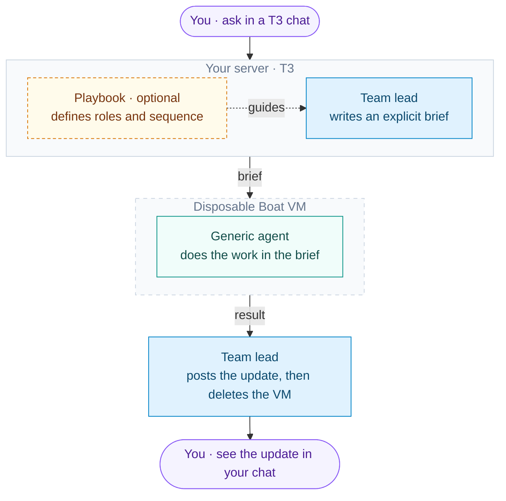

<h1 align="center">⛵ T3 Boat</h1>

<p align="center"><strong>Run a team of coding agents on disposable Boat VMs from T3 Code.</strong></p>

<p align="center">
  <a href="https://github.com/pogorelov17/t3-boat/actions/workflows/release.yml"></a>
  <a href="https://hub.docker.com/r/pogorelov17/t3-boat"></a>
</p>

<p align="center">
  <a href="#quick-start">Quick start</a> · <a href="https://github.com/pogorelov17/t3-boat/releases/latest">Latest release ↗</a> · <a href="https://hub.docker.com/r/pogorelov17/t3-boat">Docker Hub ↗</a> · <a href="https://github.com/pogorelov17/agent-playbook">Agent Playbook ↗</a>
</p>

T3 Boat runs T3 Code in a Docker container on your Linux server. You discuss a task with a team lead in T3, using Codex, Claude or both. When the work touches a repository, the lead writes an explicit brief for an agent on a fresh Boat VM and reports the outcome back in your chat.



For each delegation, result or decision, the lead posts a short update with links instead of shell logs. For example, after you ask “Fix the failing date test, explain why it broke and open a pull request with the fix.”:

> - **Who → whom:** lead → worker on `bx_7f3k` (child chat), Codex, lead model, high effort
> - **Asked:** reproduce the failing `test_parse_iso_date`, fix it and open a pull request
> - **Depends on:** `main` at `4e1c9a2`
> - **Result:** the parser dropped the `Z` offset; fixed in `src/dates.py`; `pytest` 142 passed, 0 failed; pull request `#42` opened
> - **Decision:** `#42` is ready for your review.

With a [playbook](#2-choose-a-playbook-optional) attached, its roles and their order decide who gets the next brief. The update takes the same form.

**What survives cleanup.** The lead copies each outcome into your chat before it deletes the worker's VM. Afterwards, the T3 history on your server and whatever the worker actually delivered elsewhere, such as a pushed branch or a pull request, remain. The worker's checkout, its chat and anything else left on the VM are gone.

Your server hosts T3 and handles worker provisioning and cleanup. The lead can plan and check a fact on the web. Workers clone the project, install its dependencies, edit its source and run builds and tests on Boat VMs.

## Quick start

You need a Linux server with curl and [Docker Engine](https://docs.docker.com/engine/install/) (AMD64 or ARM64), a Boat account that can start a small VM, a GitHub account and the subscriptions for your profile. A repository is optional.

### 1. Start the container

Run this on the server. It looks up the [latest release](https://github.com/pogorelov17/t3-boat/releases/latest) and pulls its image from Docker Hub:

```sh
VERSION=$(curl -fsSLo /dev/null -w '%{url_effective}' https://github.com/pogorelov17/t3-boat/releases/latest |
  sed -n 's|.*/releases/tag/v\([0-9][0-9.]*\)$|\1|p')
echo "T3 Boat ${VERSION:?could not resolve the latest release}" &&
  docker pull "pogorelov17/t3-boat:$VERSION"
```

Set `T3_BOAT_PROFILE` to `codex-only`, `claude-only` or `codex+claude`, then start it on a new volume. T3 shows the container hostname as its display name.

```sh
docker run -d --name t3-boat --hostname "$(hostname -s)" --restart unless-stopped \
  -p 127.0.0.1:3773:3773 \
  -v t3-boat-data:/data \
  -e T3_BOAT_PROFILE=codex+claude \
  "pogorelov17/t3-boat:${VERSION:?run the commands above first}"
```

Use a fresh data volume for a clean install. If another container uses `t3-boat-data`, choose a new volume name to keep your previous chat history. To build the image yourself instead, run `docker build -t t3-boat:custom .` from a checkout of this repository and start that tag.

### 2. Choose a playbook (optional)

Setup asks for a playbook right after sign-in, so decide before you run it. Without one, the lead briefs a generic worker for each task and decides how many to start and in what order. A playbook is an external package, a `team.json` manifest with role guides, that defines the roles, their instructions, their sequence and optionally their models. T3 Boat reads it as data and only launches its workers. It applies to every project of this profile and adds nothing to your repositories.

At the **Playbook** prompt, enter one of these:

- **Enter** for none: a generic worker. This is the default on a fresh install.
- `agent-playbook` to download [agent-playbook](https://github.com/pogorelov17/agent-playbook) in the version selected for this T3 Boat release.
- The path of a package inside the container, such as your own package under `/data/teams`.

To use the current [agent-playbook main branch](https://github.com/pogorelov17/agent-playbook/tree/main) instead, run this before setup and enter `/data/teams/agent-playbook-main` at the prompt:

```sh
docker exec t3-boat git clone --depth 1 --branch main https://github.com/pogorelov17/agent-playbook /data/teams/agent-playbook-main
```

When you attach a package, setup also asks which of its roles the lead follows and, if a compatible model set is available, which one to use.

### 3. Connect your accounts and verify a worker

Before you start, prepare Boat: choose a private worker environment with GitHub access whose credential profile, under **Agents & Proxying**, connects the same subscriptions as your profile. For repository work, grant the Boat GitHub App **Contents** and **Pull requests** write access. [Boat environments](https://docs.boat.dev/environments/access) · [Worker subscriptions](https://docs.boat.dev/ai-credentials)

```sh
docker exec -it t3-boat t3-boat setup
```

Setup asks, in this order:

1. **Sign in** to each provider of your profile. Valid sessions are reused.
2. **Playbook:** press **Enter** for a generic worker, or enter your choice from [step 2](#2-choose-a-playbook-optional).
3. **Lead model:** the model and reasoning level of your chats, which every worker also opens with. Press **Enter** to accept the one shown, or type `edit` to choose another.
4. **GitHub repository URL:** enter a project URL, or press **Enter** to start with an idea in **Start here**.
5. **Boat:** approve the device login if prompted, then select your worker environment. If prompted, confirm the repository attachment.

Setup then checks the connections on a temporary VM, deletes it and finishes with **Setup verified**.

**Change it later.** Run the same setup command again to change the lead model (type `edit`), attach another playbook or detach it with `none`, or add a repository by entering its URL. Where setup shows a saved default, press **Enter** to keep it. To check the installation without starting a VM, run `docker exec t3-boat t3-boat status`.

### 4. Open your first chat

**First time connecting this computer?** For a remote server, forward the port from your computer and keep this session open:

```sh
ssh -L 127.0.0.1:3773:127.0.0.1:3773 -o ExitOnForwardFailure=yes USER@SERVER
```

Then, on the server, create a pairing link:

```sh
docker exec -it t3-boat t3 auth pairing create --ttl 5m --base-url http://127.0.0.1:3773
```

In the desktop app, open **Settings → Environments → Add environment → Remote link** and paste the URL, or open it in a browser to pair that browser. Issue a fresh link for each client.

If you skipped the repository URL, open **Start here** to plan your idea. When you are ready to delegate project work, rerun setup with the repository URL.

Open a chat in your repository and describe the task. For example:

> Fix the failing date test, explain why it broke and open a pull request with the fix.

The lead turns this into a brief for a worker and posts updates like the example at the top of this page. If you attached a playbook, its roles and sequence already apply; you do not need to mention them.

**Phone or another device (optional):** run `docker exec -it t3-boat t3 connect --headless` and follow the browser prompt, restart the container between tasks, then select the T3 Connect route in the T3 Code app on that device.
